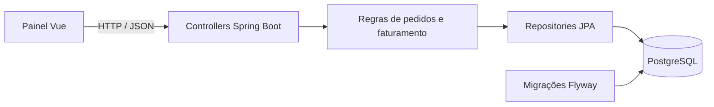

# Art Pizza · pedidos e operação

[](https://github.com/FernandoTorresD97/automatizacao-artpizza/actions/workflows/verify-and-publish.yml)

Aplicação de portfólio de **Fernando Torres**, com API Java 21 / Spring Boot e painel Vue 3 para acompanhar pedidos, produção e vendas.

**Demonstração:** https://fernandotorresd97.github.io/automatizacao-artpizza/

A demonstração pública funciona exclusivamente no navegador, com dados fictícios e armazenamento local. Permite simular pedidos, avançar etapas e acompanhar o resumo de vendas. **Não é uma operação comercial e não acessa o backend, WhatsApp ou serviços de pagamento.** Os testes e o backend deste repositório são independentes dessa demonstração.

## O que está implementado

O [laboratório integrado](docs/LABORATORIO-INTEGRADO.md) acrescenta pagamentos fictícios, webhook de teste assinado e integração autenticada com a Notification API via outbox transacional. Sem conta em provedor: nenhum pagamento real ou sandbox externo é efetuado. A demo pública continua sem acesso ao backend.

- Pedidos de pizzas e produtos, preços calculados no servidor e limites de sabores.
- Frete por bairro, entrega ou retirada e bloqueio de itens indisponíveis.
- Máquina de estados que impede saltos de etapas e cancelamentos após o preparo.
- Liberação manual de pedidos PIX por endpoint específico, sem confundir com confirmação bancária.
- PostgreSQL com migrações Flyway e validação do esquema pelo Hibernate.
- Controle otimista de concorrência: uma atualização com versão antiga é rejeitada com HTTP 409.
- Validação de entrada, respostas de erro e autenticação administrativa HTTP Basic.
- Painel de pedidos e resumo de vendas por data e forma de pagamento.
- Testes de integração HTTP com PostgreSQL real temporário, sem depender de H2 ou Docker.
- Pipeline que verifica backend e demo antes da publicação no GitHub Pages.

## Arquitetura



O backend permanece em uma aplicação com responsabilidades separadas. Não é necessário distribuir o processo de pedidos em microsserviços para demonstrar consistência, validação e concorrência.

## Execução completa com PostgreSQL

Requer Docker Engine com Compose. Na raiz:

```powershell
Copy-Item .env.example .env
# Edite .env: DB_PASSWORD, ADMIN_USERNAME e ADMIN_PASSWORD.
docker compose up --build
```

Abra http://localhost:8088 e entre com o usuário e a senha definidos em `.env`. O PostgreSQL persiste os dados no volume `postgres-data`; reiniciar os serviços não apaga os pedidos. Não use `docker compose down -v` se quiser preservar esses dados.

O banco e a API ficam na rede interna do Compose; o painel local usa Nginx como proxy. Credenciais administrativas não são incluídas no JavaScript nem persistidas pelo painel: ficam em memória durante a sessão. Em uma publicação real, use HTTPS, configure credenciais próprias e restrinja o acesso administrativo.

### Desenvolvimento sem Docker

JDK 21 e Maven 3.9+:

```powershell
cd backend
$env:SPRING_PROFILES_ACTIVE = 'dev'
mvn spring-boot:run
```

O perfil `dev` usa H2 temporário e usuário/senha `admin` apenas para desenvolvimento. Os dados são perdidos ao reiniciar. O perfil `prod` exige `DB_URL` (JDBC), `DB_USER`, `DB_PASSWORD`, `ADMIN_USERNAME` e `ADMIN_PASSWORD`; usa PostgreSQL e migrações.

Em outro terminal, Node 22+:

```powershell
cd painel
npm ci
npm run dev
```

O Vite encaminha `/api` para `localhost:8080`. Faça login na interface. **Não coloque senhas em variáveis `VITE_*`: elas são públicas no build.**

## Demonstração independente

```powershell
cd painel
npm ci
npm run build:demo
npm run preview
```

O modo demo não faz chamadas de API. Cada navegador tem seu próprio conjunto de pedidos; `Reiniciar demo` restaura os exemplos. O faturamento considera pedidos confirmados, em preparo, prontos, em entrega e entregues, pela data local de criação; não representa lucro ou conciliação bancária.

## Verificação

```powershell
cd backend
mvn verify
cd ../painel
npm test
npm run build
npm run build:demo
```

A suíte Java usa PostgreSQL nativo temporário via Zonky Embedded Postgres. Não precisa instalar um servidor local; o primeiro build baixa as dependências e os binários do banco. Usa o perfil `prod`, Flyway e `ddl-auto=validate`, com credenciais exclusivas de teste.

Cenários cobertos: preços e frete, limites de sabores, disponibilidade, rollback de criação inválida, observações de 500 caracteres, fluxo completo, cancelamentos, confirmação PIX, autorização, filtro inválido e conflito de versão. Os testes Java não usam o simulador de frontend.

## Endpoints principais

| Método | Rota | Acesso |
|---|---|---|
| GET | `/api/cardapio/tamanhos`, `/api/cardapio/sabores`, `/api/cardapio/produtos` | Público |
| GET | `/api/frete?bairro=...` | Público |
| POST | `/api/pedidos` | Público |
| GET | `/api/pedidos`, `/api/pedidos/{id}` | Administrador |
| PATCH | `/api/pedidos/{id}/status` | Administrador |
| PATCH | `/api/pedidos/{id}/confirmar-pagamento` | Administrador |
| GET | `/api/faturamento?data=AAAA-MM-DD` | Administrador |

## Integrações: limites atuais

O atendimento pode ser exercitado em `/api/whatsapp-simulador/mensagem`. O envio real do WhatsApp fica desligado por padrão e exige configuração da conta Meta. O webhook de pagamento é genérico, desligado por padrão e ainda não é integração homologada com provedor. Não use esse endpoint como evidência de recebimento bancário.

A confirmação PIX atual é manual. **Ainda não estão implementados:** integração de pagamento em sandbox com validação de valor e idempotência, perfis distintos de atendente/admin, auditoria de alterações e integração com a Notification API. Essas entregas estão no [plano de evolução](docs/ROADMAP.md).

## Publicação

Em Settings → Pages, selecione **GitHub Actions**. A branch `main` executa os testes, compila a demo e a publica automaticamente. O GitHub Pages hospeda apenas o frontend demonstrativo; a API Java e o banco precisam de uma hospedagem separada para uma operação real.

## Autor

Fernando Torres · [GitHub](https://github.com/FernandoTorresD97) · [LinkedIn](https://linkedin.com/in/fernandotorresdias/)
